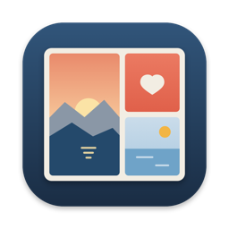
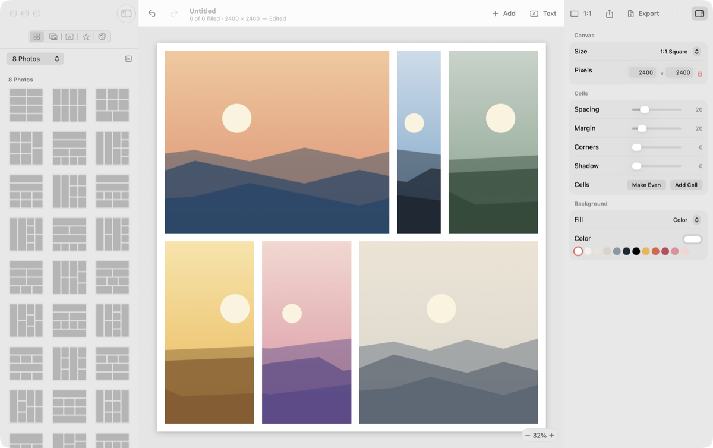

<p align="center"></p>

# Mosaikk

A native macOS app for making photo collages, entirely on your Mac. Pick a layout, drop in your photos, drag the borders between them until it looks right, and add text, stickers and a background. *Mosaikk* is Norwegian for mosaic.

<p align="center"></p>

- **Layouts**: over 200 grids, feature layouts and mosaics for 1 to 25 photos, shaped frames (circle, heart, star, hexagon, arch, pebble), and freeform collages where photos lie loose like prints
- **Drag the borders** between cells to resize them; lines that run through the whole grid move together (hold ⌥ to move one part). Split a cell side by side or top and bottom, delete it, add cells, or make them all even again
- **Photos**: drag inside a cell to choose the crop, pinch or use the slider to zoom, drag a photo onto another cell to swap them, turn and flip, Auto Fill and Shuffle
- **Looks**: 16 filters with adjustable strength, and exposure, brightness, contrast, saturation, warmth, tint, highlights, shadows, hue, vignette, sharpness and blur for each photo
- **Spacing, margins, rounded corners and shadows** for the whole grid
- **Text** with any installed font, bold, italic, underline, capitals, alignment, letter spacing and line height, outline, shadow, glow and a highlight box; 14 ready-made styles; type straight onto the canvas
- **Stickers**: shapes, badges, decorations and emoji, with colour, outline and shadow
- **Free layer**: move, resize from every edge and corner, rotate, snap to the centre and edges, change opacity, lock, duplicate and stack items
- **Backgrounds**: colours, linear and radial gradients, eight patterns, a blurred photo, or transparent
- **Canvas sizes** for proportions (1:1, 4:5, 9:16, 16:9 and more), social media (Instagram, Facebook, X, YouTube, Pinterest, LinkedIn) and print (A4, US Letter, 4 × 6, 5 × 7), or any size up to 12,000 pixels
- **Export** PNG, JPEG or HEIC at any size, with transparency where the format allows; copy the collage, or share it
- **Documents**: each collage is a `.mosaikk` file that keeps the original photos, so it opens anywhere and stays editable. Autosave, versions, and undo for every change
- English, English (UK), Simplified Chinese and Traditional Chinese, following the system language
- Runs in the App Sandbox with no network access; no accounts, no analytics ([privacy policy](PRIVACY.md))

**Download:** Mosaikk 1.0 is free. Get the signed, notarized disk image from [Releases](https://github.com/tangfy97/Mosaikk/releases/latest) ([tang-spark.no/mosaikk](https://tang-spark.no/mosaikk.html)); it is coming to the Mac App Store. It needs macOS 14 Sonoma or later, on Apple silicon or Intel.

## Build

Requires Xcode and [XcodeGen](https://github.com/yonaskolb/XcodeGen) (`brew install xcodegen`).

```sh
scripts/build.sh          # build/Mosaikk.app, signed to run locally
scripts/test.sh           # engine tests: layouts, editing, rendering, the document format
scripts/preflight.sh      # tests, then builds both release configurations and checks them before shipping
scripts/snapshots.sh      # scripted session with real mouse events, captured into build/snapshots
```

`project.yml` is the source of truth for the Xcode project; edit it rather than the `.xcodeproj`, then run `xcodegen generate`. The `Release` configuration is the website build and `AppStore` the Mac App Store build; both run in the App Sandbox with no network entitlement.

| Script | What it does |
|---|---|
| `scripts/appstore.sh` | App Store build: signed installer package, and `upload` sends it to App Store Connect |
| `scripts/release.sh` | Download build: Developer ID, notarized, as a DMG and zip in `build/release` |
| `scripts/github-release.sh` | Publishes that build as a GitHub release, which tang-spark.no links to |
| `scripts/publish-website.sh` | Copies the pages from `website/` into the tang-spark.no site (no installers) |
| `scripts/localize.sh` | Exports every string and fills in the translations from `scripts/translations.py` |
| `scripts/icon.swift` | Renders the app icon into the asset catalogue |
| `scripts/sample-photos.swift`, `scripts/storeshot.swift` | Generated sample pictures and App Store screenshot composition |

How it is built: [docs/DEVELOPMENT.md](docs/DEVELOPMENT.md). Design principles: [docs/DESIGN.md](docs/DESIGN.md). Releasing: [docs/APP_STORE.md](docs/APP_STORE.md). Open problems: [docs/KNOWN_ISSUES.md](docs/KNOWN_ISSUES.md).

## License

Copyright © 2026 TangSpark. Released under the [Apache License 2.0](LICENSE). Contributions: [CONTRIBUTING.md](CONTRIBUTING.md). Security: [SECURITY.md](SECURITY.md).
